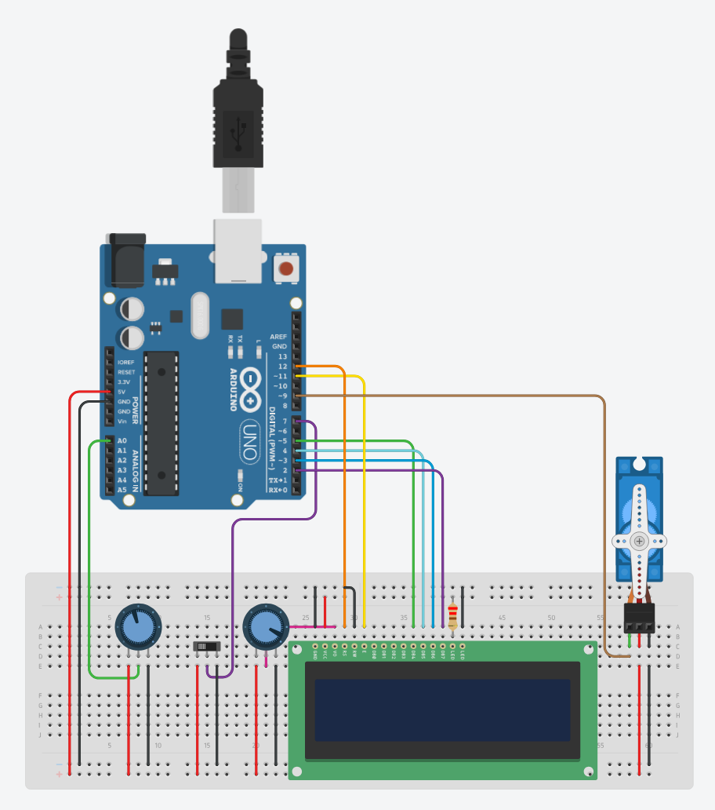

# Sistema de Gerenciamento de Recarga de Bateria para Smartphones

Simulação no Tinkercad de um BMS simplificado para baterias de Íon-Lítio, seguindo o perfil de carga **CC-CV**.

**Disciplina**: DCA3706 - SISTEMAS EMBARCADOS

**Professor**: Matheus Vitor de Andrade Pedrosa

**Aluno**: Israel Soares de Castro Filho

**Link para Tinkercad**: [Gerenciamento_Bateria - Israel Filho](https://www.tinkercad.com/things/3VGncqqSMev-gerenciamentobateria?sharecode=YdT8VbNx6dsX3EdmXjw3DD4HJVfJyQV1JHIunquXXfM)

## Como funciona

- **Fase CC (0% a 80%)**: corrente máxima, servo em 180°.
- **Fase CV (80% a 100%)**: a corrente cai linearmente, `ângulo = 180 × (100 − carga) / 20`.
- **Desconectado ou 100%**: corrente zero, servo em 0°.

O tempo restante de recarga é estimado assim:

| Faixa | Fórmula (minutos) |
|---|---|
| Carga ≤ 80% | `(80 − carga) × 1,5 + 60` |
| Carga > 80% | `0,15 × (100 − carga)²` |
| Carga = 100% | `0` |

## Hardware

| Componente | Função | Pino |
|---|---|---|
| Arduino Uno | Microcontrolador | n/a |
| Potenciômetro 250k | Nível da bateria (0–100%) | A0 |
| Slide switch | Cabo do carregador (HIGH = conectado) | D7 |
| Servo motor | Amperímetro analógico (0°–180°) | D9 |
| LCD 16x2 | Interface com o usuário | RS=12, E=11, D4=5, D5=4, D6=3, D7=2 |

**Slide switch**: common em D7, terminal 1 em 5V e terminal 2 em GND.

**LCD**: RW em GND, potenciômetro de 10k no VO (contraste) e resistor de 220 Ω no LED+.

## Display

| Situação | Linha 1 | Linha 2 |
|---|---|---|
| Desconectado | `Bateria: XX%` | `Desconectado` |
| Carregando | `Bateria: XX%` | `Tempo: YY min` |
| Carga completa | `Bateria: 100%` | `Carga Concluida` |

No canto superior direito há um ícone de bateria. Durante a carga ele é animado (6 quadros, de vazia a cheia); nos demais casos fica parado e mostra o nível atual.

## Como executar

1. Monte o circuito no Tinkercad seguindo o [esquemático do circuito](assets/schematic.pdf).
2. Abra o editor de código, escolha o modo **Texto** e cole o conteúdo de `gerenciamento_bateria.cpp`.
3. Clique em **Iniciar simulação**.
4. Gire o potenciômetro para mudar o nível da bateria e alterne o slide switch para conectar ou desconectar o carregador.

## Arquivos

- `assets/circuit_tinkercad.png`: imagem do circuito montado no simulador Tinkercad
- `assets/schematic.pdf`: esquemático do projeto
- `gerenciamento_bateria.ino`: código-fonte do Arduino
- `README.md`: este arquivo