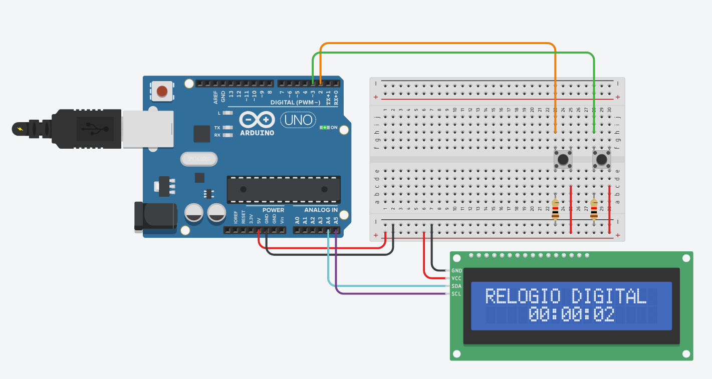

# Relógio Digital de Pulso Utilizando Temporizadores

Simulação no Tinkercad de um relógio digital com Arduino Uno, display LCD 16x2 (I2C) e dois botões. A contagem do tempo usa `millis()`, sem `delay()`, de modo que a contagem, a leitura dos botões e a atualização do display rodam ao mesmo tempo.

**Disciplina**: DCA3706 - SISTEMAS EMBARCADOS

**Professor**: Matheus Vitor de Andrade Pedrosa

**Aluno**: Israel Soares de Castro Filho

**Link para Tinkercad**: [Trabalho 4 - Israel Filho](https://www.tinkercad.com/things/8qPdp3RGEK3-trabalho-4?sharecode=56Zdg3otadoFey86Jr64w86EUCDW6VpJFJktUf-KN2k)

## Como funciona

- **Base de tempo**: sempre que `t_atual − t_anterior ≥ 1000 ms`, o relógio soma um segundo. `t_anterior` avança em passos de 1000 ms, o que evita acumular erro.
- **Contagem**: segundos e minutos vão de 0 a 59 e horas de 0 a 23. Ao passar do limite, o campo volta a zero e incrementa o seguinte.
- **Hora inicial**: o relógio começa em `00:00:00` sempre que o Arduino é ligado ou reiniciado. A hora correta é definida pelo modo de ajuste.
- **Modo de ajuste**: a contagem fica pausada e os dois dígitos do campo selecionado piscam (500 ms acesos, 500 ms apagados). Ao sair, a contagem continua a partir da hora configurada.
- **Debounce**: cada botão só muda de estado depois de ficar 30 ms estável. A duração do pressionamento é `Δt = t_solto − t_pressionado`.

### Botões

| Botão | Ação | Efeito |
|---|---|---|
| Ajuste | Pressionamento longo (≥ 1 s) | Entra ou sai do modo de ajuste |
| Ajuste | Clique rápido (< 1 s), no modo de ajuste | Troca o campo: Segundos → Minutos → Horas → Segundos |
| Avanço | Clique, no modo de ajuste | Incrementa o campo selecionado: `(valor + 1) mod 60` ou `(horas + 1) mod 24` |

Fora do modo de ajuste, o clique rápido no botão de ajuste e o botão de avanço são ignorados.

## Hardware

| Componente | Função | Pino |
|---|---|---|
| Arduino Uno | Microcontrolador | n/a |
| LCD 16x2 (I2C, endereço 0x20) | Interface com o usuário | SDA=A4, SCL=A5 |
| Botão de ajuste (S1) | Entrar/sair do ajuste e trocar o campo | D2 |
| Botão de avanço (S2) | Incrementar o campo selecionado | D3 |
| 2 resistores de 1 kΩ | Pull-down dos botões | D2 e D3 para GND |

**Botões**: um terminal no 5V e o outro no pino digital, com o resistor de 1 kΩ do pino para o GND (pull-down). O pino lê HIGH com o botão pressionado. Para ligar os botões direto no GND sem resistor, use `INPUT_PULLUP` no `setup()` e `NIVEL_PRESSIONADO = LOW`.

**LCD**: VCC no 5V e GND no GND.

## Display

| Situação | Linha 1 | Linha 2 |
|---|---|---|
| Modo relógio | `RELOGIO DIGITAL` | `HH:MM:SS` |
| Modo de ajuste | `AJUSTE DE HORA` | `HH:MM:SS` (campo selecionado piscando) |

## Como executar

1. Monte o circuito no Tinkercad seguindo o [esquemático do circuito](assets/schematic.pdf).
2. Abra o editor de código, escolha o modo **Texto** e cole o conteúdo de `relogio.cpp`.
3. Clique em **Iniciar simulação**.
4. Segure o botão de ajuste por pelo menos 1 s para entrar no modo de ajuste. Use cliques rápidos nele para trocar o campo e o botão de avanço para mudar o valor. Segure de novo por 1 s para voltar ao relógio.

O simulador costuma rodar mais devagar que o tempo real. Para a pressão longa, conte 1 s no tempo de simulação mostrado pelo Tinkercad.

## Arquivos

- `assets/circuito_tinkercad.png`: imagem do circuito montado no simulador Tinkercad
- `assets/schematic.pdf`: esquemático do projeto
- `assets/projeto-relogio.pdf`: enunciado do projeto
- `relogio.cpp`: código-fonte do Arduino
- `README.md`: este arquivo
