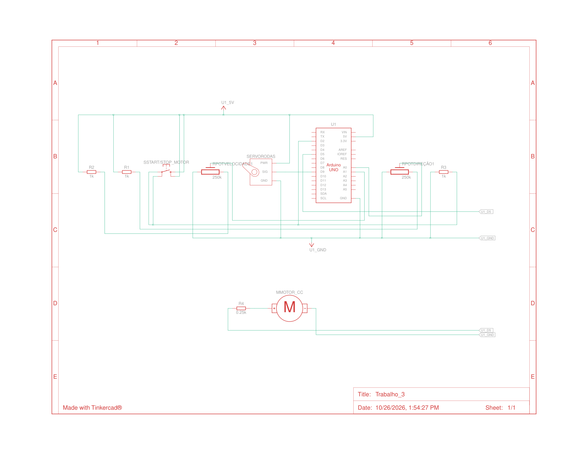

# Controle de Velocidade e Direção de um Veículo Elétrico em Miniatura

Projeto da disciplina **Sistemas Embarcados (2026.2)**, Departamento de Engenharia de Computação e Automação, Universidade Federal do Rio Grande do Norte (UFRN).

- **Autor:** Israel Soares
- **Data:** 26/10/2026
- **Plataforma:** Arduino Uno, simulado no Tinkercad
- **Link do projeto:** [Trabalho 3 Tinkercad](https://www.tinkercad.com/things/iEMNT9xanIS-trabalho3?sharecode=EYQtQBGLpjWg2hovaR78Lbzme5ajMSDeBmlu-75C_2Y)
- **Arquivo principal:** `veiculo.ino`

## Descrição

Sistema embarcado que controla a aceleração, a frenagem e a direção de um veículo elétrico em miniatura. O motor CC de propulsão é acionado por **PWM** e um **servomotor** simula o posicionamento das rodas dianteiras.

O objetivo é que o veículo responda de forma suave, mesmo quando o usuário pede mudanças abruptas nos potenciômetros. Para isso, o PWM aplicado ao motor não segue diretamente a referência de velocidade: ele se aproxima dela em passos pequenos e regulares. O sistema também tem uma função de partida, que liga o motor em baixa rotação.

## Funcionalidades

- Leitura contínua do potenciômetro de direção e conversão para o ângulo do servo.
- Leitura contínua do potenciômetro de velocidade e conversão para uma referência de PWM (0 a 255).
- Aceleração e frenagem graduais (rampa de PWM).
- Botão de partida que liga e desliga o motor, com *debounce* e detecção de borda.
- Partida em baixa rotação (`PWM_BAIXO`), sem passar pela rampa.
- Partida bloqueada se o potenciômetro de velocidade não estiver em zero.
- Execução sem `delay()`: o temporizamento usa `millis()`, então o `loop()` nunca trava.
- Monitor Serial com o status do sistema a cada 250 ms.

## Hardware

| Componente | Quantidade | Função |
|---|---|---|
| Arduino Uno | 1 | Microcontrolador |
| Motor CC | 1 | Propulsão do veículo (controlado por PWM) |
| Servomotor | 1 | Direção das rodas dianteiras |
| Potenciômetro | 1 | Controle de direção |
| Potenciômetro | 1 | Controle de velocidade |
| Botão | 1 | Partida (liga e desliga o motor) |

### Pinagem

| Pino | Nome no código | Função |
|---|---|---|
| `A0` | `PINO_DIRECAO` | Potenciômetro de direção |
| `A1` | `PINO_VELOCIDADE` | Potenciômetro de velocidade |
| `2` | `PINO_BOTAO` | Botão de partida (`INPUT_PULLUP`) |
| `5` | `PINO_MOTOR` | Saída PWM para o motor CC |
| `9` | `PINO_SERVO` | Sinal do servomotor |

**Botão:** como o pino usa `INPUT_PULLUP`, um terminal do botão vai ao pino 2 e o outro ao GND, sem resistor externo. O botão solto lê `HIGH` e pressionado lê `LOW`.

**Motor:** o motor CC não deve ser ligado diretamente ao pino do Arduino. Use o estágio de potência do seu circuito no Tinkercad (por exemplo, transistor ou ponte H) comandado pelo pino 5.

## Esquemático

Esquemático do circuito montado no Tinkercad, com as ligações do Arduino Uno, do motor CC, do servomotor, dos dois potenciômetros e do botão de partida:



## Modelagem

### Direção

A leitura de `A0` (0 a 1023) é convertida para o ângulo do servo, e o ângulo das rodas é calculado a partir dele:

```
θ_rodas = θ_servo − 90
```

| Situação esperada | Servo | Rodas |
|---|---|---|
| Curva para um lado | 45° | −45° |
| Posição central | 90° | 0° |
| Curva para o outro lado | 135° | +45° |

> **Observação:** o enunciado define `map(analogRead(A0), 0, 1023, 45, 135)`. O código atual usa `map(leitura, 0, 1023, 135, 45)`, ou seja, o sentido está **invertido** (pot. no mínimo resulta em 135° e no máximo em 45°). Se for necessário seguir o enunciado à risca, troque os dois últimos argumentos de `map()` em `atualizaDirecao()`.

O servo só recebe um novo comando quando o ângulo muda, o que evita escritas desnecessárias.

### Aceleração e frenagem gradual

Seja `PWM_atual` o valor aplicado ao motor e `PWM_referência` o valor pedido pelo potenciômetro. A cada atualização:

```
PWM_atual = PWM_atual + ΔPWM

ΔPWM = +a   se PWM_atual < PWM_referência
       −a   se PWM_atual > PWM_referência
        0   se PWM_atual = PWM_referência
```

com `0 ≤ PWM_atual ≤ 255`. O parâmetro `a` é o `PASSO_PWM`. O código limita o passo para não ultrapassar a referência e aplica `constrain()` como proteção final.

A referência vem de `map(analogRead(A1), 0, 1023, 0, 255)` com um piso: `max(potRef, PWM_BAIXO)`. Assim, com o motor ligado, o PWM nunca cai abaixo da rotação de partida.

Com os parâmetros atuais (`a = 5` a cada 20 ms), a rampa é de 250 unidades de PWM por segundo. Ir de `PWM_BAIXO` (40) a 255 leva cerca de 0,9 s.

### Partida em baixa velocidade

Ao acionar o botão com o motor desligado:

1. Se `analogRead(A1) <= TOLERANCIA_ZERO`, o motor liga com `PWM_atual = PWM_BAIXO`, aplicado diretamente, **sem rampa**.
2. Caso contrário, a partida é negada e o Serial mostra uma mensagem pedindo para levar o pot. de velocidade a zero.

Ao acionar o botão com o motor ligado, o motor desliga imediatamente (`PWM = 0`).

## Estrutura do código

| Função | Responsabilidade |
|---|---|
| `botaoPressionado()` | Lê o botão com *debounce* e retorna `true` apenas na borda de descida (pressionamento) |
| `atualizaDirecao()` | Lê o pot. de direção e atualiza o servo e `anguloRodas` |
| `tratarBotao()` | Liga ou desliga o motor conforme o botão e a condição do pot. de velocidade |
| `atualizaMotor()` | Calcula a referência de PWM e aplica a rampa a cada `INTERVALO_PWM_MS` |
| `imprimeStatus()` | Imprime o estado do sistema no Serial a cada `INTERVALO_SERIAL_MS` |
| `setup()` / `loop()` | Inicialização e laço principal, que chama as quatro funções acima em sequência |

### Parâmetros ajustáveis

| Constante | Valor | Descrição |
|---|---|---|
| `PWM_BAIXO` | 40 | PWM de partida (motor ligado, sem mover o veículo) |
| `PASSO_PWM` | 5 | Incremento de PWM por atualização (parâmetro `a`) |
| `INTERVALO_PWM_MS` | 20 ms | Intervalo entre atualizações do PWM |
| `DEBOUNCE_MS` | 50 ms | Tempo de *debounce* do botão |
| `INTERVALO_SERIAL_MS` | 250 ms | Período de impressão no Serial Monitor |
| `TOLERANCIA_ZERO` | 2 | Leitura (0 a 1023) considerada "zero" no pot. de velocidade |

Para uma rampa mais suave, reduza `PASSO_PWM` ou aumente `INTERVALO_PWM_MS`. Para uma rampa mais agressiva, faça o contrário.

## Como executar no Tinkercad

1. Monte o circuito conforme a tabela de pinagem.
2. Abra o editor de código e cole o conteúdo de `veiculo.ino` (modo texto).
3. Abra o **Monitor Serial** (9600 baud).
4. Inicie a simulação. O motor começa **desligado**.
5. Com o pot. de velocidade em zero, clique no botão para ligar o motor em baixa rotação.
6. Gire o pot. de velocidade para acelerar e reduza para frear. O PWM muda de forma gradual.
7. Gire o pot. de direção para mover o servo.
8. Clique novamente no botão para desligar o motor.

## Exemplo de saída no Serial

```
>> Motor LIGADO (baixa rotacao)
Motor: ON  | PWM ref: 40 | PWM atual: 40 | Servo: 90 deg | Rodas: 0 deg
Motor: ON  | PWM ref: 255 | PWM atual: 105 | Servo: 90 deg | Rodas: 0 deg
Motor: ON  | PWM ref: 255 | PWM atual: 255 | Servo: 120 deg | Rodas: 30 deg
>> Motor DESLIGADO
Motor: OFF | PWM ref: 0 | PWM atual: 0 | Servo: 120 deg | Rodas: 30 deg
```

## Conceito importante

O PWM controla a **potência média** aplicada ao motor CC, mas não determina diretamente a velocidade real. A velocidade depende da tensão de alimentação, da carga mecânica, das características elétricas do motor e das perdas do sistema. Neste projeto, o valor de PWM é tratado como uma **referência de acionamento**, e não como uma medição da velocidade do veículo.